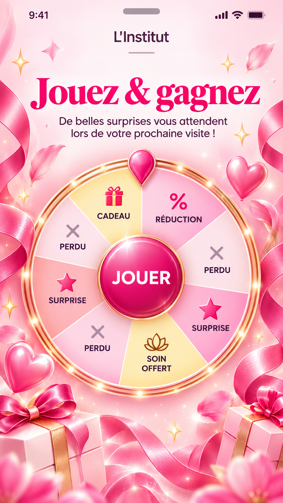

# Beauty Pop — #626

## Référence propriétaire

Refonte autorisée le 23 octobre 2026. Conserver l'identifiant du modèle,
les textes et réglages personnalisables, les vrais lots et le moteur existant.
Pas de copie de l'heure, de la batterie ou de l'encoche de la référence.

## Réalisation et comparaison

[Rendu public](beauty-pop-626-public.webp) ·
[Aperçu compact](beauty-pop-626-preview.webp) ·
[Vrai wizard à1280×600](beauty-pop-626-wizard.webp)

- Fond raster issu de la référence : rubans satinés, pétales, cœurs, cadeaux
  en bas et touches dorées ; centre dégagé, sans texte ni roue dans l'image.
- Titre Bodoni fuchsia par défaut, logo et sous-titre prune. Aucune surcharge
  de graisse 800 pour Beauty Pop : le réglage du marchand est respecté.
- Secteurs rose/ivoire/champagne en dégradé, contour métallique avec 24 points
  lumineux, pointeur fuchsia bordé d'or, disque JOUER brillant sans icône.
- Cadre et lumières placés hors du conteneur en rotation. Après retour
  propriétaire : aucun pictogramme dans les segments, libellés centrés avec
  l'orientation radiale et la police DM Sans communes aux autres roues Beauté.
- Sous-titre centré à80% de son conteneur, plafonné à26ch, pour dégager les
  éléments latéraux du fond sans réduire sa taille de police.
- Miniature harmonisée. Dans l'aperçu compact, suppression de la double
  réduction du titre et des espacements, et ancrage de la roue après le texte
  plutôt que remontée par translation : le pointeur ne couvre plus le sous-titre.

Écarts assumés : les pictogrammes de la référence sont retirés à la demande
du propriétaire. Les libellés, pertes et dispositions
reflètent les vrais lots du jeu, pas la distribution illustrative de la référence.
Le rendu s'adapte à la hauteur utile du navigateur plutôt qu'à un plein écran
de smartphone simulé. Ne pas présenter la fidélité comme une mesure objective.

### Ajustement après retour propriétaire

Le sous-titre passe de30ch à80% du conteneur, avec un plafond26ch, sans
réduction de police. Les textes de lots retrouvent le même ancrage, orientation
radiale et calcul de taille que les autres roues Beauté ; décalage sous icône
et plafonnement de taille spécifiques retirés. Aucun pictogramme de segment
ou import Lucide correspondant ne subsiste dans la roue. Le fond, les dorures,
le pointeur et le bouton ne changent pas. Les tests contrôlent la largeur
effective, l'absence de pictogrammes et l'orientation des huit libellés.
Les8tests dédiés et77tests de finitions/thèmes ont été rejoués avec succès.
Captures public/aperçu mobile et vrai wizard1280×720/600 inspectées puis mises
à jour : sous-titre recentré loin des rubans et libellés sans icône, sans
chevauchement avec le pointeur. Aucun réglage utilisateur ni asset de fond changé.

## Assets et provenance

Générateur intégré imagegen, mode édition de la référence, sans API/CLI externe.
Original conservé dans le répertoire generated_images du poste ; seules les
versions optimisées sont nécessaires au site :

- `apps/web-app/public/images/wheel-templates/beauty-pop-ribbons.webp`
  : 941×1672 px, 93 784 octets, WebP qualité85.
- `apps/web-app/public/images/wheel-templates/beauty-pop-ribbons-thumb.webp`
  : 240×426 px, 8 414 octets, WebP qualité75.

Ajout natif à la bibliothèque, sans migration Supabase ni copie dans le champ
image du marchand. Exceptions explicites dans `.vercelignore` pour les deux
assets ; vérifier leurs URL sur la preview Vercel du commit candidat.

### Prompt utilisé

> Edit the supplied reference into a production-ready portrait background image ONLY for an interactive beauty prize wheel. Preserve its exact rosy luminous luxury style, satin hot pink swirling ribbons along the far left and right edges, floating rose petals, polished pink heart balloons, delicate warm golden glints, and wrapped pale pink gift boxes with fuchsia bows in the bottom corners. REMOVE ALL foreground UI: remove time, phone/status icons and notch, logo/name, every word and letter, subtitle, decorative logo line, the entire circular wheel including gold ring, every segment, icon, pointer and play button. Fill the removed areas seamlessly with luminous pale blush pink, almost ivory in the upper center. Composition: leave the central 76 percent width clear for live text in the upper third and a real interactive wheel in the middle; keep ribbons mostly at outer edges. Keep bottom-corner gifts in bottom 18 percent of canvas, not in middle. Portrait 9:16 composition matching reference, rich realistic satin texture, pink/cream/fuchsia and soft rose gold, polished dimensional lighting. No wheel, no circular frame, no text, no logo, no smartphone frame, no watermarks. This is the final raster background, not a mockup.

## Périmètre et risques

Changements spécifiques au modèle. Éclat et les autres thèmes conservent leurs
finitions. Les paramètres existants et les choix manuels restent prioritaires :
un ancien jeu Beauty Pop ne perd pas sa police ou sa couleur personnalisée.
Les nouveaux défauts complets sont proposés lors d'un nouveau choix de modèle.
Pas de migration, nouvelle dépendance, permission ou traitement de données.
Le rollback applicatif retire l'habillage ; il ne nécessite aucun rollback SQL.

## Vérifications

### Exemple du site vitrine — #652, 25 octobre 2026

`apps/landing-page/public/images/game-beauty-pop.webp` est recapturé avec le
renderer courant de `CampaignExperience`, via la fixture de développement
`/dev/beauty-wheel-backgrounds?mode=marketing&template=beauty-pop`.
Ce mode conserve l’enseigne fictive Maison Botanique et « Une surprise / vous
attend », mais utilise la typographie Bodoni, les couleurs et le fond natifs
du modèle, sans les anciennes surcharges de la capture marketing générique.
Les lots illustratifs viennent de la fixture Beauty Pop ; aucun jeu réel.
Le rendu public est capturé sans bandeau de prévisualisation ni indicateur Next.js.

Capture 390 × 844 avec facteur 2, puis conversion Sharp WebP qualité 80,
effort 6 : **780 × 1688, 79 630 octets**. Même fichier partagé par la carte,
la popin d’agrandissement et les autres utilisations marketing de Beauty Pop.

Recette reproductible : démarrer le SaaS local en développement ; définir
`PLAYWRIGHT_BASE_URL` vers ce serveur et `MARKETING_CAPTURE_TEMPLATE=beauty-pop`,
puis exécuter dans `apps/web-app` :
`npm run test:e2e -- game-screen-layout --grep "game screens marketing"`.
Le PNG `game-beauty-pop.png` est produit dans les résultats Playwright avant
conversion en WebP. La recette bloque les sorties HTTPS et intercepte toutes
les API ; elle attend le fond et les polices, vérifie le titre fuchsia/Bodoni,
les 24 lumières et l’absence de chevauchement sous-titre/pointeur. La route
de fixture conserve son HTTP 404 en production. Aucun moteur de jeu modifié.

`beauty-pop.spec.ts` : fond/miniature réellement décodables et budgets de poids,
présence dans la bibliothèque et packaging, captures publiques/aperçu à320/390px
et hauteur740px, bouton visible, titre et sous-titre distincts du pointeur,
personnalisation, fond manuel et changement de template, contour fixe pendant
une vraie animation et résultat unique. Vrai wizard et navigation à1280×720/600,
galerie puis popin d'aperçu. Les fixtures sont interdites en production.

Suites existantes : fonds des roues Beauté, finitions des six thèmes et Éclat,
palettes sans voisins identiques, contraste, personnalisation et traitement des
segments. API et analytics interceptés ; aucun gain ni envoi réel.

Captures locales : `apps/web-app/test-results/beauty-pop-626-final`.
Les preuves locales ne valent pas déploiement ou validation propriétaire.

120 tests des fonds/finitions/interactions ont réussi en une exécution.
Les huit scénarios dédiés ont ensuite été rejoués avec la popin d'aperçu du
vrai wizard, en traversant son iframe. Le premier test de cette popin cherchait
le bouton dans le document parent et utilisait un jeu déjà doté de réglages
personnalisés : il a été corrigé pour tester une première sélection réelle
de Beauty Pop et le bon document, sans changer les données ni les préférences.
Une vérification conserve aussi le blanc du bouton sur l'ancien rose natif,
avec le même ajustement de contraste qu'avant la refonte.

Le contrôle des messages navigateur a ensuite détecté un écart de précision
trigonométrique Node/navigateur sur une lumière (environ10⁻¹³) : coordonnées
arrondies à3décimales pour une hydratation stable. Le parent de l'image fill
porte aussi explicitement position:relative avant le chargement des CSS dans
l'iframe. Les tests refusent ces avertissements au lieu de les ignorer.

Dernier passage dédié :8tests réussis, sans ces avertissements ; build et
TypeScript réussis, lint sans erreur (4avertissements antérieurs hors périmètre),
verify:source et diffcheck réussis. Aucune suppression d'assertion de rendu ni
d'erreur pour obtenir ces résultats. Audit des dépendances de main connu en
échec (Next.js/DOMPurify) : aucune exception ou mise à niveau incluse ici.
