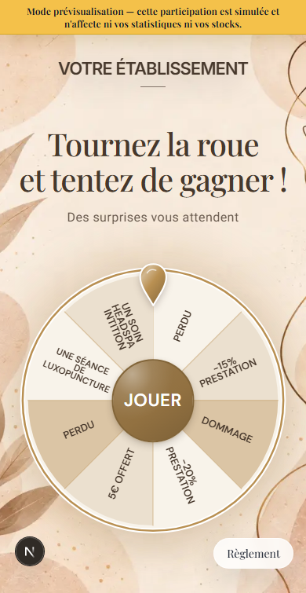

# Ajustement local des libellés de roue — #631

## Demande et analyse

Le propriétaire demande de réduire légèrement la police du seul lot trop long,
exemple UNE SÉANCE DE LUXOPUNCTURE sur Nude. Le minimum global de 25 unités SVG
annulait le réglage prévu pour les textes sur trois lignes ; le mot long pouvait
passer sous le bouton central. Les autres lots doivent rester inchangés.

## Correction

La taille de référence et la découpe en lignes existantes sont conservées.
`FittedWheelLabel` mesure le texte SVG réel avant peinture, puis après chargement
des polices. Le calcul vérifie le dégagement du bouton, le rayon extérieur et
l'angle du secteur. Seul un texte qui ne tient pas est réduit, par pas de 0,1
unité SVG ; interligne et centrage suivent cette réduction. Aucun textLength,
scaleX ou étirement des lettres. La mise à jour est locale et réévaluée si le
libellé, la police ou la géométrie changent. Le rendu serveur initial reste
déterministe ; aucun accès document pendant le rendu SSR, aucun appel API.
Les écouteurs de chargement de polices sont retirés au démontage ; aucun
observateur de taille par pixel n'est nécessaire car le SVG se redimensionne
uniformément.

Portée : `WheelOfFortune` partagé par les modèles Beauté et roues classiques.
Les rendus spéciaux autonomes Halloween/immersifs/Cocorico ne sont pas modifiés
par cette correction ciblée. Aucune retouche de fond, pointeur, bouton, contraste,
tirage, stock, probabilité, libellé enregistré ou ordre des lots. Pas de migration.
Cette PR ne reprend pas les changements SQL de #629/PR #630.

## Contrôles

- Calcul : libellés courts inchangés, texte long légèrement réduit, pas
  d'agrandissement, mesure nulle sans erreur.
- Rendus public/aperçu mobile 320/390 px des six Beauté et Éclat : lots présents,
  PERDU garde sa taille ; Nude luxopuncture réduit et ne passe plus sous le bouton.
- Vrai wizard/iframe 1280×720/600 et finitions/animations Beauty Pop/Éclat conservés.
- Lint/build web, TypeScript, verify:source et diffcheck requis.
- API interceptées/données synthétiques ; aucune donnée ou session réelle.
- Captures à inspecter : public390 et aperçu1280×600 ; SVG mesuré dans Chromium,
  aucune validation sur appareil iOS physique revendiquée.

Résultats : 110 tests réussis en une exécution (cas long/court, fonds, thèmes,
finitions, animation et aperçus). Le contrôle du lot long et du lot court a
ensuite été renforcé dans l'iframe du wizard et rejoué avec succès aux deux
hauteurs 1280×720/600. Captures public390 et aperçu1280×600 inspectées ; les
styles mémorisés synthétiques du wizard sont volontairement conservés.
Lint zéro erreur / quatre avertissements antérieurs, build web/TypeScript,
verify:source et diffcheck réussis. Audit de production : zéro alerte au second
passage après une première sortie JSON indisponible ; aucun garde-fou modifié.

## Livraison / retour arrière

Branche basée sur #627 pour conserver la correction des lots masqués et les
dépendances corrigées. Fusionner #627, puis retargeter sur main pour obtenir
les checks CI. Validation propriétaire avant merge/production. Revert applicatif
si régression ; pas de rollback SQL.
