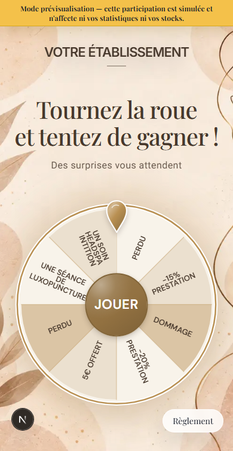

# Visibilité des lots de roue — #628

## Analyse et décision

Demande propriétaire du 23 octobre 2026 : corriger le lot headspa absent sur
Nude. Avec les chances 15/10/10/5/5 %, le générateur commun place headspa en
neuvième position sur dix. Le filtre Beauté tronquait à huit, conservant quatre
pertes et masquant ce lot. Le stock et le tirage serveur ne sont pas en cause.

Chaque lot distinct et la perte doivent être représentés. Huit secteurs sont
une cible de présentation, pas une limite métier : au-delà de huit issues
distinctes, afficher davantage de secteurs. Les répétitions passent après les
lots distincts. Des libellés identiques ne fusionnent pas deux identifiants.

## Implémentation

`selectWheelVisualSegments` conserve un représentant par identifiant de lot,
remplace les répétitions superflues et préserve l'identifiant exact du résultat
(y compris une copie visuelle) pour l'animation. Pas de mutation des entrées,
pas de segment inventé, pas de changement du générateur pondéré ou du tirage.
Sélection partagée par les six modèles Beauté, Éclat et Restaurant Pop.
Halloween possède déjà son propre contrôle des lots distincts, conservé.

Le modèle public et l'aperçu utilisent le même composant. Aucune migration,
écriture de campagne, changement de probabilités, de stock ou de résultat.
Les surfaces, pointeurs, boutons et couleurs restent inchangés.

## Vérifications

- `test:wheel-segments` : cas headspa exact, repos et tous les résultats,
  identifiants uniques, absence de mutation, 1 à 50 lots avec libellés identiques,
  avec/sans perte, vide et probabilités non éligibles. Ajouté au job qualité CI.
- `wheel-prize-visibility.spec.ts` : les cinq lots et une perte présents dans
  les vrais rendus public/aperçu des six Beauté et Éclat, 320/390 px ; wizard
  avec les cinq lots à 1280×720/600. Données synthétiques et API interceptées.
- Suites thèmes, finitions et Beauty Pop maintenues ; lint/build requis.
- Les fixtures `/dev/*` demeurent inaccessibles en production.

Résultats locaux : quatre tests unitaires du sélecteur ; quinze tests navigateur
de visibilité (dont les deux hauteurs du wizard) ; onze tests de thèmes et huit
Beauty Pop réussis. Les 66 contrôles de finitions ont réussi ; le premier passage
avec le nouveau test wizard a échoué car la roue, masquée à cette largeur,
n'était pas ouverte dans l'iframe. Le test a été corrigé pour ouvrir « Voir
l'aperçu » et ses quinze cas ont été rejoués avec succès, sans modifier
l'interface pour faire passer le test. Capture mobile inspectée : les cinq
lots sont présents. Capture 1280×600 inspectée : popin et roue contenues ;
la fixture du wizard conserve volontairement ses styles mémorisés de test.
Lint : zéro erreur et quatre avertissements antérieurs. Builds SaaS et vitrine,
TypeScript, vérification des sources et diffcheck réussis sous Next 16.4.2.

## Recette propriétaire et retour arrière

Ouvrir le jeu concerné, vérifier le headspa dans l'aperçu intégré puis le QR
de prévisualisation. Ne pas changer les chances pour réparer l'affichage.
Le nombre de cases affichées n'est pas la probabilité réelle de gain.
Revert applicatif si régression ; aucun rollback SQL nécessaire.
