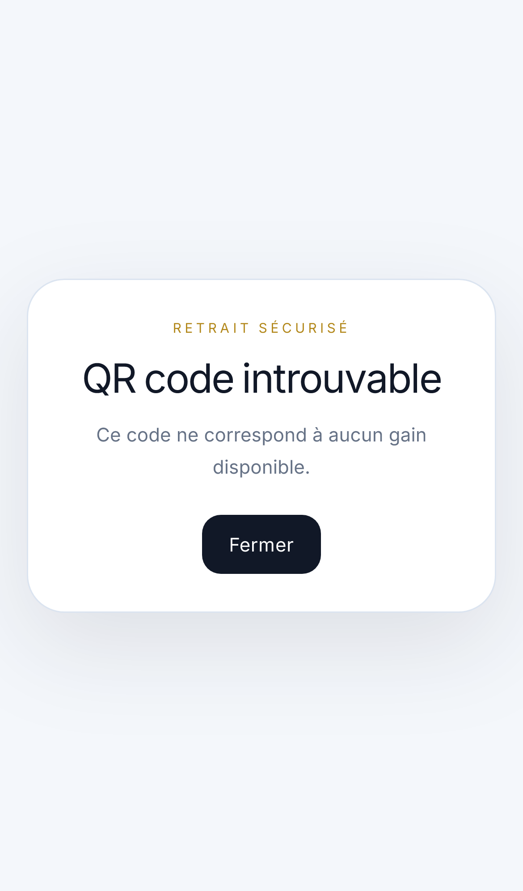
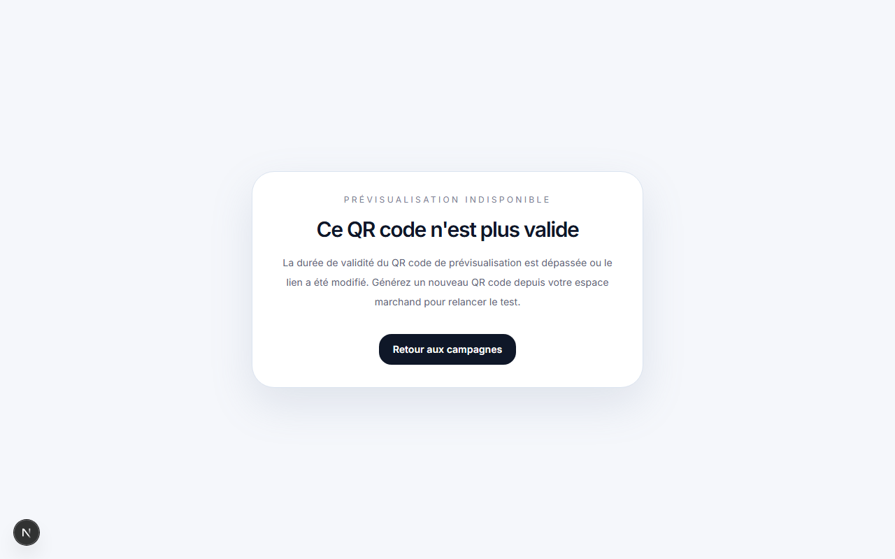

# Audit du parcours joueur et de la remise des gains — Issue #860

**Date :** 28 novembre 2026  
**Version examinée :** `origin/main` au commit `1285785` (Next.js 16.4.6)  
**Branche de correction :** `codex/player-redemption-audit-860`  
**Environnements utilisés :** worktree local uniquement. Supabase désactivé pour les E2E; aucune donnée de production, participation, stock, retrait, notification ou e-mail réel n’a été utilisé.

## Synthèse

L’issue #860 a été créée pour réunir l’audit et les corrections ciblées. Le niveau P0 correspond à la priorité demandée pour le chantier : **aucun défaut P0 n’a été reproduit dans les scénarios locaux exécutés**. Trois défauts P1 ont été établis par lecture des flux et corrigés dans la branche : les coordonnées et identifiants internes transmis à la page publique de retrait, les données sensibles écrites dans les journaux de support, et l’absence d’alternative clavier au grattage.

Les contrôles locaux confirment la compilation, les tests ciblés de parcours/SQL et les E2E publics disponibles. Une fixture Playwright rend le vrai composant du jeu avec des réponses API contrôlées : elle vérifie la révélation clavier en immersif à 320 et 390 px et en classique desktop. L’audit reste partiel pour les parcours gagnants et retraits réels, les appareils physiques, les mesures de performance et les e-mails. Aucun score de conformité ne peut donc être affirmé. À titre d’orientation seulement, l’état initial est estimé à **7/10 pour le parcours joueur** et **7/10 pour le retrait**, avec un niveau de confiance faible faute de recette complète.

**Risque résiduel : moyen à élevé** jusqu’à la décision sur l’entropie et la limitation des recherches de codes, ainsi qu’au traitement autorisé des anciennes lignes de journaux. Les corrections de cette PR réduisent les expositions futures; elles ne nettoient pas l’historique.

### Points forts constatés

- Le résultat est préparé côté serveur et la prévisualisation reste isolée du jeu réel.
- Les RPC de retrait sont transactionnelles, contrôlent le périmètre marchand et distinguent le retrait standard du retrait forcé.
- Le retrait forcé exige le PIN et un motif; son journal métier conserve les éléments minimum approuvés, dont le code et le motif.
- Les tests SQL locaux couvrent la réutilisation idempotente, le refus d’une réutilisation incompatible, les règles de validité et d’achat obligatoire, et le refus d’accès `anon`/`authenticated` aux RPC protégées.

### Parcours réels documentés

```mermaid
flowchart LR
  QR[QR de diffusion] --> PAGE[Page publique du jeu]
  PAGE --> GATE{Action ou coordonnées préalables requises ?}
  GATE -->|oui| ACTION[Action / formulaire configuré]
  GATE -->|non| PREP[Préparation de session côté serveur]
  ACTION --> PREP
  PREP --> RESULT[Résultat de session]
  RESULT -->|perte| LOST[État perdant]
  RESULT -->|gain| WIN[Affichage du gain]
  WIN --> CONTACT{Coordonnées nécessaires ?}
  CONTACT -->|oui| FINAL[Finalisation et e-mail selon le parcours]
  CONTACT -->|non| CODE[Code et QR de retrait]
  FINAL --> CODE

  CODE --> PLAYER[Présentation au commerce]
  PLAYER --> CASHIER[Recherche dans /caisse]
  CASHIER --> CHECK[Gain, conditions, période et statut]
  CHECK --> PIN[PIN marchand]
  CHECK -->|retrait forcé| REASON[Motif + PIN]
  PIN --> RPC[RPC transactionnelle]
  REASON --> RPC
  RPC --> AUDIT[Confirmation et journal métier]
```

Le schéma résume les branches présentes; il ne constitue pas une preuve de recette de chaque variante.

## Registre des anomalies

| ID | Gravité / statut | Écran ou système | Preuve et impact | Suite |
|---|---|---|---|---|
| A-01 | **P1 — corrigé** | `/redeem/[code]`, `GET /api/public/redeem/[code]` | Le modèle public brut contenait l’adresse e-mail et des identifiants internes (`leadId`, `campaignId`, `merchantId`). Le rendu client utilisait l’adresse complète. Défaut établi par le chemin de données; non rejoué avec un code de gain valide faute de fixture locale sûre. | Projection explicite `PublicRedemptionView`; seule l’adresse masquée et les champs d’affichage nécessaires passent au client. Test unitaire vérifie l’absence des champs privés. |
| A-02 | **P1 — corrigé pour les nouveaux journaux** | Journalisation opérationnelle / `business_logs` | Les appels de retrait et de finalisation pouvaient envoyer e-mail, identifiants de joueur/opérateur, code de retrait et motif libre au logger commun (mémoire, console et table). Le code/PIN ne doit jamais apparaître dans les journaux. | Sanitizer central : supprime coordonnées, identifiants personnels, codes, PIN, secrets et motifs libres; l’insertion n’écrit plus les colonnes `email` et `redemption_code`. Le journal métier `cashier_redemption_audits` reste intact selon la règle approuvée. **Les anciennes lignes ne sont pas modifiées.** |
| A-03 | **P1 — corrigé** | Ticket à gratter public | La toile n’écoutait que les événements pointeur; elle n’était pas une commande clavier. Une personne ne pouvant pas gratter ne disposait d’aucune alternative. | Ajout de « Révéler le résultat » pour les templates immersifs et classiques. L’action réutilise la session déjà préparée, enregistre au plus une participation et ne demande aucun nouveau tirage. Garde par identifiant de session et test unitaire d’idempotence. Vérification manuelle sur appareil/lecteur d’écran non réalisée. |
| A-04 | **P1 — risque théorique, décision requise** | Code public de retrait | Les migrations générant les codes utilisent `SORA-` suivi de 8 caractères hexadécimaux (32 bits). La lecture du contexte par code est publique et aucun limiteur applicatif n’a été trouvé sur la page/lecture GET. Une énumération n’a pas été tentée. | Décider d’un format à entropie plus forte, de la compatibilité avec les codes/QR existants et d’une limite persistante sur les lectures publiques. Changement de format/migration à approuver; aucune requête de production n’a été faite. |
| A-05 | **P2 — question produit ouverte** | Retrait forcé / documentation | `DOMAIN_RULES.md` impose déjà motif + PIN et journal minimum; `PRODUCT.md` garde ouverte la définition exacte des critères présentés et journalisés au personnel. Ce n’est pas une contradiction complète, mais le niveau d’affichage demandé reste ambigu. | Préciser les critères d’affichage dans le document produit. Aucun changement de règle de retrait n’a été introduit. |
| A-06 | **P2 — test corrigé** | Harnais de `test:participations` | Le test du handler ne simulait pas `next/server.after` ni l’envoi Brevo asynchrone; le premier scénario échouait alors que l’environnement du test n’exécutait pas le runtime Next. | Ajout de stubs au test; la suite passe maintenant 11/11 sans envoyer de message. |
| A-07 | **Couverture à compléter** | Retraits concurrents | Les tests SQL couvrent les appels répétés séquentiels avec la même clé et le refus d’une clé incompatible. Une véritable course de deux requêtes distinctes n’a pas été exercée dans un serveur Supabase local. | Ajouter/faire exécuter une recette de concurrence sur un environnement local de base de données adapté avant de conclure sur le scénario concurrent. |

## Validation technique

| Contrôle | Résultat |
|---|---|
| `npm ci` | Réussi; 0 vulnérabilité signalée par npm audit. |
| `test:metrics` | 21/21 réussis, dont tests SQL PGlite et idempotence séquentielle. |
| `test:participations` | 11/11 réussis après correction du harnais local. |
| `test:guaranteed-draw` | 11/11 réussis. |
| `test:preview-qr` | 7/7 réussis. |
| `test:wheel-segments` | 6/6 réussis. |
| `test:public-redemption-context` | 1/1 réussi. |
| `test:support-log-sanitize` | 2/2 réussis. |
| `test:session-action-guard` | 1/1 réussi. |
| `e2e/public-safety.spec.ts` | 4/4 réussis sur Chromium local, avec Supabase désactivé. États couverts : destination image invalide, jeton de prévisualisation invalide, code de retrait introuvable, génération SVG du QR. |
| E2E de révélation clavier | 3/3 réussis : scratch immersif à 320 et 390 px, template classique à 1280 px. Vérifie une seule session préparée, une seule participation, un état `game_lost` cohérent et aucun tirage supplémentaire. |
| E2E `participation`, `gain-popins`, `game-screen-layout` | 38 réussis; 1 test de gain flaky a dépassé son délai en attendant le dialogue « Jouer maintenant », puis a réussi au retry (serveur Webpack local sous `CI=true`). |
| Lint | `npm run lint --workspace @okado/web-app -- src e2e` : 0 erreur, 4 avertissements `window.location.assign()` préexistants dans les formulaires d’inscription et de gestion d’établissement, hors fichiers modifiés. Le lint sans chemins a aussi parcouru `playwright-report/trace/assets` généré par E2E et échoué sur le code vendor de ces artefacts; le contrôle source + E2E est passé. |
| Build / TypeScript | `next build` réussi sous Next.js 16.4.6. |
| `git diff --check` | Réussi (fichiers CRLF vérifiés avec `core.whitespace=cr-at-eol`). |
| Checks Vercel sur la PR | 2/2 réussis (`growth`, `okado-index`). Aucun statut GitHub Actions n’est apparu dans les statuts consultés. |

Les avertissements Node `MODULE_TYPELESS_PACKAGE_JSON` observés pendant les tests ne font pas échouer les suites.

## Captures de l’application locale — erreurs

Ces deux captures viennent de l’application locale réelle et montrent des erreurs effectivement vérifiées.

## Captures du composant avec fixture Playwright

Ces captures rendent le vrai composant React et son style avec campagne, résultat et API fictifs interceptés par Playwright. Elles vérifient visuellement l’emplacement du bouton clavier, notamment sur un viewport étroit de 320 px. Elles ne représentent pas une campagne publiée ni un retrait réel. Les six fichiers ont été produits par les trois scénarios d’E2E clavier décrits plus haut.

| Variante / viewport | Résultat prêt | Après révélation |
|---|---|---|
| Scratch immersif — 320 px | [Capture](issue-860-screenshots/scratch-immersive-320-ready-320.png) | [Capture](issue-860-screenshots/scratch-immersive-320-lost-320.png) |
| Scratch immersif — 390 px | [Capture](issue-860-screenshots/scratch-immersive-ready-390.png) | [Capture](issue-860-screenshots/scratch-immersive-lost-390.png) |
| Ticket classique — 1280 px | [Capture](issue-860-screenshots/scratch-classic-ready-1280.png) | [Capture](issue-860-screenshots/scratch-classic-lost-1280.png) |

## Limites et scénarios non exécutés

- Pas de campagne locale publiée avec gains déterministes permettant de capturer les formulaires avant/après, un QR/code valide ou un retrait; les captures scratch utilisent une fixture Playwright et couvrent une révélation perdante contrôlée.
- Pas de recette de bout en bout d’un gain réel ou de ses variantes conditionnelles; l’E2E agrégé a connu un timeout flaky sur une attente de dialogue de gain, réussi au retry.
- Pas de recette réelle des templates actifs, des longues valeurs, du responsive complet, des navigateurs intégrés ou des appareils iOS/Android.
- Pas d’audit WCAG automatisé ni de test manuel lecteur d’écran/focus complet; seule l’absence de commande clavier du ticket a été vérifiée puis corrigée dans le code.
- Pas de mesures reproductibles de performance ni de réseau ralenti. Les travaux de l’issue #395 ont été consultés, mais cette PR ne revendique aucun gain de performance.
- Pas d’e-mail de test envoyé; le contenu d’e-mail n’a pas été rendu dans un client de messagerie.
- Pas de requête, modification ou nettoyage en production; pas de vérification Vercel des journaux HTTP qui pourraient conserver le code présent dans le chemin `/redeem/[code]`.
- Pas de capture vidéo des animations ni de retrait concurrent réel.

## Décisions demandées et recommandation

1. **Recommandation — entropie et limite de lecture :** approuver un format de code plus fort et une protection persistante contre l’énumération, avec plan de compatibilité pour les codes déjà distribués. Conséquence : migration et recette des anciens QR/code requis.
2. **Recommandation — ancien journal opérationnel :** autoriser une analyse puis un nettoyage ciblé des anciennes lignes `business_logs` qui contiennent e-mail/code. Conserver intégralement le journal d’audit métier `cashier_redemption_audits`, requis par les règles métier. Conséquence : migration SQL de données et plan de retour arrière à préparer après accord.
3. **Recommandation — retrait forcé :** préciser les champs exacts que le personnel doit voir avant confirmation dans `docs/PRODUCT.md`, sans relâcher motif, PIN ou journalisation déjà approuvés.
4. **Recommandation — recette visuelle complète :** fournir ou approuver une fixture locale de campagne publiée couvrant gain/perte, collecte avant/après, validité/expiration, PIN et retrait forcé; cela permettra de compléter les captures desktop/mobile sans toucher aux données de production.

## Fichiers touchés

- `apps/web-app/src/app/api/merchant/cashier/redeem/route.ts`
- `apps/web-app/src/app/api/public/redeem/[code]/route.ts`
- `apps/web-app/src/app/redeem/[code]/page.tsx`
- `apps/web-app/src/components/public/campaign-experience.tsx`
- `apps/web-app/src/components/public/express-redemption.tsx`
- `apps/web-app/src/components/public/immersive-scratch-ticket.tsx`
- `apps/web-app/src/lib/public-redemption-context.ts` et son test
- `apps/web-app/src/lib/session-action-guard.ts` et son test
- `apps/web-app/src/lib/support-log.ts`
- `apps/web-app/src/lib/support-log-sanitize.ts` et son test
- `apps/web-app/src/lib/participation-api.test.mjs`
- `apps/web-app/e2e/fixtures/participation.tsx`, `apps/web-app/e2e/participation.spec.ts` et `apps/web-app/src/app/dev/participation-proof/page.tsx`
- `apps/web-app/package.json`
- `docs/releases/issue-860-player-redemption-audit.md` et les huit captures référencées

**Retour arrière du code :** revert de la PR. Aucune migration SQL n’est incluse.
